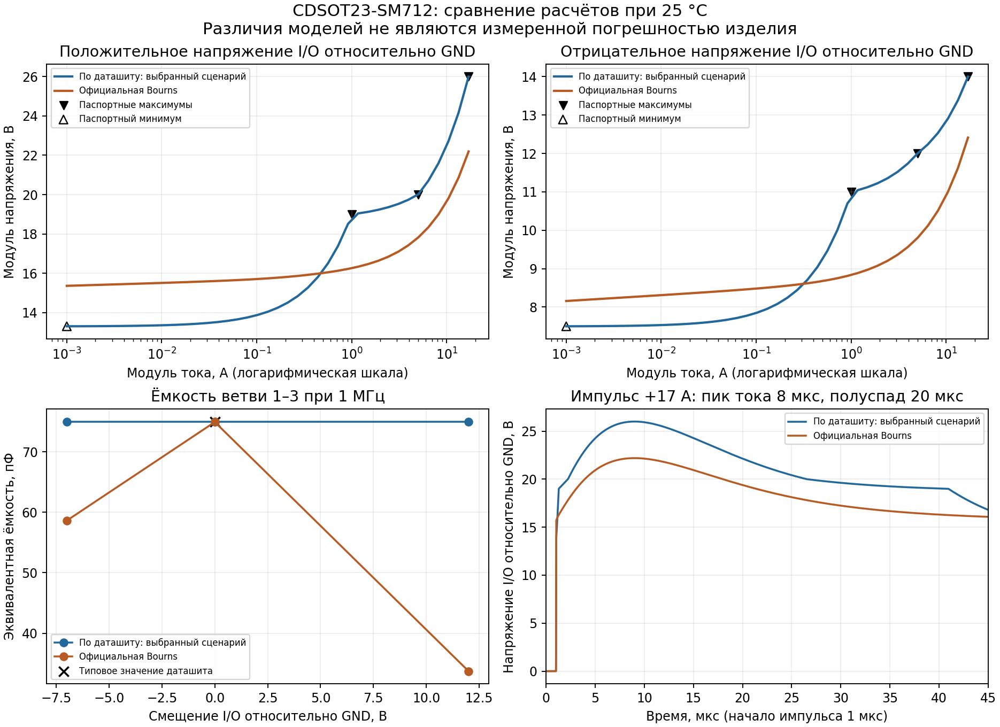

# CDSOT23-SM712 — модель MY_LIB по даташиту

Компонент **U0005 / CDSOT23-SM712** использует `MY_LIB_CDSOT23_SM712_DS.ckt`, подсхему `MY_LIB_CDSOT23_SM712_DS`. Привязка задана в строке U0005 листа «Микросхемы» книги `MY_LIB.xlsx` через существующие сопоставления DbLib. УГО сохранено.

## Происхождение и назначение

Модель самостоятельно написана по [даташиту Bourns CDSOT23-SM712, Rev. 06/24](https://www.bourns.com/docs/product-datasheets/cdsot23-sm712.pdf), локальная копия — [Datasheets/CDSOT23-SM712_Bourns.pdf](../../Datasheets/CDSOT23-SM712_Bourns.pdf). Автор работал с чистым контекстом и не читал готовую модель Bourns. После завершения другой агент проверил модель в ngspice и сравнил с официальной; по результатам сравнения параметры не подгонялись.

Это **поведенческая аппроксимация паспортных точек при 25 °C**, не заводская модель. Из таблицы страницы 1 взяты минимальные напряжения пробоя, максимальные токи утечки, максимальные напряжения ограничения и типовая ёмкость. Между точками принята кусочно-линейная интерполяция. Сочетание min/max в одной кривой — выбранный расчётный сценарий, а не измеренная типовая ВАХ и не универсальный worst-case.

Постоянная ёмкость каждой ветви — 75 пФ. Она соответствует опубликованному типичному значению при 0 В / 1 МГц; её постоянство при других смещениях — допущение. Отдельные физические параметры TVS-переходов в даташите не приведены и не выдаются за известные.

## Сравнение с официальной моделью

Официальный источник сравнения — Bourns PSpice Version 1.0, March 2015. Графики получены расчётами ngspice из KiCad 9.0 при 25 °C, а не измерениями компонентов. Различие моделей не является измеренной погрешностью относительно реального изделия. Линия C(V) официальной модели на рисунке соединяет три расчётные точки.

| Стенд ветви I/O–GND | MY_LIB | Официальная Bourns |
|---|---:|---:|
| DC, +1 А | +19,00 В | +16,26 В |
| DC, +5 А | +20,00 В | +17,81 В |
| DC, +17 А | +26,00 В | +22,19 В |
| DC, −1 А | −11,00 В | −8,84 В |
| DC, −5 А | −12,00 В | −9,80 В |
| DC, −17 А | −14,00 В | −12,41 В |
| Ёмкость при 0 В, 1 МГц | 75,00 пФ | 74,92 пФ |
| Ёмкость при +12 В, 1 МГц | 75,00 пФ | 33,72 пФ |
| Ёмкость при −7 В, 1 МГц | 75,00 пФ | 58,62 пФ |

Проверены обе полярности и оба канала, пробой при 1 мА, утечка при рабочих напряжениях, AC, монотонность ВАХ и плавающий общий вывод. На графике импульса применена синтетическая форма с пиком тока через 8 мкс и полуспадом через 20 мкс от начала; это приближение по графику страницы 3, не сертифицированный IEC-генератор. DC-проверки не заменяют импульсные испытания.

## Ограничения

- Данные электрических точек относятся к **25 °C**. Температурная зависимость не моделируется; рабочий диапазон изделия −55…+150 °C не подтверждает точность модели во всём диапазоне.
- Нет паразитной индуктивности, зависимости C(V)/C(f), физической динамики лавины, восстановления, саморазогрева, derating, повреждения и разброса параметров. Быстрые ESD-фронты не подтверждены.
- Пределы 17 А / 400 Вт не являются встроенными ограничителями. За последней паспортной точкой продолжается последний наклон без подтверждения даташитом. Совместная импульсная нагрузочная способность двух каналов не установлена.
- Совпадение с точками, по которым построена модель, проверяет реализацию сценария, а не доказывает точность реального компонента. Полная эквивалентность официальной модели не подтверждена.
- Используются поведенческие B-источники с `max()`. Работа проверена в ngspice; нативный расчёт в Altium не проверен.

## Привязка MY_LIB

Физические выводы: **1 — I/O1, 2 — I/O2, 3 — GND / общий**. Порядок портов подсхемы: `1 2 3`. При положительном напряжении I/O относительно 3 используется 12-вольтовое направление, при отрицательном — 7-вольтовое.

| Поле строки U0005 | Значение |
|---|---|
| Sim Model Name | `MY_LIB_CDSOT23_SM712_DS` |
| Sim File | `Simulation\CDSOT23-SM712\MY_LIB_CDSOT23_SM712_DS.ckt` |
| Sim Kind | `General` |
| Sim SubKind | `Spice Subcircuit` |
| Sim Spice Prefix | `X` |
| Sim Netlist | `@DESIGNATOR %1 %2 %3 @MODEL` |
| Sim Port Map | `(1:1),(2:2),(3:3)` |

## Как установить официальную SPICE-модель Bourns

1. Откройте [официальный список файлов CDSOT23-SM712](https://bourns.com/resources/design-tools/engineering-files-list?folder=CDSOT23-SM712) и скачайте **Spice Model CDSOT23-SM712.txt**. [Прямая ссылка на текст модели](https://bourns.com/engineering/CDSOT23-SM712/Spice%20Model%20CDSOT23-SM712.txt). Ознакомьтесь с лицензией внутри файла. В использованном для сравнения выпуске указаны Version 1.0, March 2015.
2. Сохраните содержимое без изменений как `Simulation/CDSOT23-SM712/LocalVendor/CDSOT23-SM712.lib` относительно корня библиотеки. Это текстовый netlist; меняется только имя файла, а не имя подсхемы или параметры. Каталог `LocalVendor/` исключён из Git. Официальный файл не включён в распространяемый набор MY_LIB.
3. Сохраните резервную копию `MY_LIB.xlsx`. В строке **U0005** листа **«Микросхемы»** измените `Sim Model Name` на `CDSOT23-SM712`, `Sim File` на `Simulation\CDSOT23-SM712\LocalVendor\CDSOT23-SM712.lib`, а `Sim Description` — на описание скачанной официальной версии.
4. Остальные Sim-поля оставьте по таблице выше. Для указанного выпуска заголовок — `.SUBCKT CDSOT23-SM712 1 2 3`; физическая нумерация совпадает. Перед применением другого выпуска проверьте его порты и условия использования.
5. Сохраните и закройте Excel. В Altium обновите данные из DbLib или заново разместите U0005 в тестовой схеме. Для уже размещённых компонентов обновите параметры/модели из базы. Проверьте фактическое имя подсхемы, относительный путь и сопоставление выводов. DbLib и УГО менять не требуется.
6. Выполните пробный расчёт при 25 °C в своей версии Altium и оцените изменение результатов. Модель производителя может давать иные ВАХ, утечки и ёмкости; её наличие не отменяет проверки схемы.

Для возврата к модели MY_LIB восстановите значения из таблицы «Привязка MY_LIB». Заводская модель остаётся материалом Bourns с собственными условиями; не распространяйте её без соответствующего разрешения.
