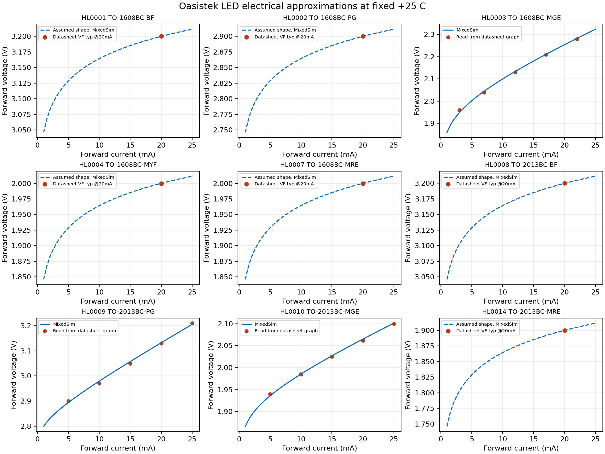

# SPICE-модели светодиодов Oasistek

Девять компонентов используют общую авторскую электрическую модель `MY_LIB_LED_DS.ckt`. Параметры `LED_IS`, `LED_N`, `LED_RS` хранятся численно в Excel и передаются через DbLib как `ISvalue`, `Nvalue`, `RSvalue`. Внешние узлы подсхемы: **1 — катод, 2 — анод**. УГО и посадочные места не менялись.

## Структура

- `MY_LIB_LED_DS.ckt` — общая параметризованная подсхема.
- `Parameters.json` — параметры девяти артикулов, источники, редакции PDF, точки подбора и контрольные чтения графиков.
- `Tests/` — девять входных JSON для Spice Tester.
- `Results/` — отчёты `.result.json`, исходные `.nsx`, результаты Altium `.sdf` и сводка `led_results_summary.json`.

В тестах путь модели относительный: `../MY_LIB_LED_DS.ckt`. Путь в Excel относительно DbLib: `Simulation\LEDs\MY_LIB_LED_DS.ckt`.

## Источники и способ построения

Открытые официальные SPICE-модели Oasistek для TO-1608BC/TO-2013BC при поиске не найдены. Модель отдельно написал сабагент по девяти индивидуальным даташитам; готовые модели других производителей не использовались. Проверены сайт [Oasistek](https://www.oasistek.com/en/) и поиск по производителю, артикулам и SPICE. Это описание результата поиска, а не утверждение, что закрытых моделей производителя не существует.

| ID | Артикул | Основание прямой ВАХ при +25 °C |
|---|---|---|
| HL0001 | TO-1608BC-BF | VFtyp=3,2 В при 20 мА, [GS15110003](../../Datasheets/Oasistek_LED/TO-1608BC-BF.pdf), стр.2 |
| HL0002 | TO-1608BC-PG | VFtyp=2,9 В при 20 мА, [GS1705005](../../Datasheets/Oasistek_LED/TO-1608BC-PG.pdf), стр.2 |
| HL0003 | TO-1608BC-MGE | Типовая кривая, [GS1511006](../../Datasheets/Oasistek_LED/TO-1608BC-MGE.pdf), стр.4 |
| HL0004 | TO-1608BC-MYF | VFtyp=2,0 В при 20 мА, [GS1511023](../../Datasheets/Oasistek_LED/TO-1608BC-MYF.pdf), стр.2 |
| HL0007 | TO-1608BC-MRE | VFtyp=2,0 В при 20 мА, [GS1705006](../../Datasheets/Oasistek_LED/TO-1608BC-MRE.pdf), стр.2 |
| HL0008 | TO-2013BC-BF | VFtyp=3,2 В при 20 мА, [GS1511032](../../Datasheets/Oasistek_LED/TO-2013BC-BF.pdf), стр.2 |
| HL0009 | TO-2013BC-PG | Типовая кривая, [GS1706012](../../Datasheets/Oasistek_LED/TO-2013BC-PG.pdf), стр.4 |
| HL0010 | TO-2013BC-MGE | Типовая кривая, [GS100130](../../Datasheets/Oasistek_LED/TO-2013BC-MGE.pdf), стр.4 |
| HL0014 | TO-2013BC-MRE | VFtyp=1,9 В при 20 мА, [GS1705011](../../Datasheets/Oasistek_LED/TO-2013BC-MRE.pdf), стр.2 |

Для трёх кривых параметры подобраны по визуально оцифрованным точкам. Отдельные контрольные точки на том же печатном графике не входили в подбор; они не являются независимыми измерениями изделия. Окно сравнения этих точек в тестах — ±50 мВ.

Для шести одноточечных моделей автор явно выбрал `N=2`, `RS=0` и вычислил IS для прохождения паспортной VFtyp при 20 мА. Одной точки недостаточно для определения формы ВАХ: остальные токи у этих шести представляют выбранную аппроксимацию. Рабочая область электрической оценки — 1…25 мА; точность шести одноточечных моделей вне 20 мА не подтверждена.

Каталожные характеристики в прежних обычных полях Excel сохранены. Их нельзя смешивать с данными индивидуальных редакций для SPICE: в частности, VFtyp у TO-1608BC-PG равна 2,9 В, у TO-2013BC-MRE — 1,9 В в использованных PDF. У MGE2013 типовая кривая даёт около 2,065 В при 20 мА, а таблица — 2,0 В; модель следует кривой. У PG2013 выбран N=1, поскольку свободная регрессия почти прямой печатной кривой давала отрицательный N.



Сплошные линии — модели трёх оцифрованных кривых; пунктир — выбранная форма одноточечных моделей. Точки — прочитанные паспортные значения. Линии рассчитаны Altium MixedSim через Spice Tester.

## Реализация и область применимости

Математическая прямая ветвь: `VF = N·VT25·ln(1+IF/IS) + IF·RS`, где `VT25 ≈ 0,02569257912 В`.

Standalone NSX MixedSim 24.4 ограничил очень малые прямые значения `.MODEL IS`, что исказило начальный вариант. В окончательной модели `.MODEL IS=1e-28`, численный `AREA=ISvalue/1e-28`, а `.MODEL RS=RSvalue·AREA`. Native AREA масштабирует ток насыщения и обратно масштабирует сопротивление, поэтому эффективные IS/N/RS и исходные цели сохранены. AREA здесь не является физической площадью кристалла. Дополнительных источников смещения или резисторов нет. Передача параметров и совместная работа девяти различных экземпляров проверены нативно.

Температура электрического перехода **зафиксирована на +25 °C** через `Dforward … TEMP=25`. Глобальная температура схемы не изменяет эту модель LED. Реальная температурная зависимость и саморазогрев не моделируются. В тестах с глобальными −55/+25/+85 °C отдельно проверен резистивный термоконтроль, чтобы отличить фиксацию LED от игнорирования температуры всем симулятором.

Модель не описывает световую отдачу, спектр, яркость, допуски, старение, тепловую цепь и ограничение тока/мощности. `CJO=0`, `TT=0` отключают неподтверждённые динамические эффекты; это не паспортное утверждение о нулевой ёмкости или времени переключения. BV не задан: допустимые обратные 5 В не являются измеренным пробоем. IS получен из прямой ВАХ и не является измеренной обратной утечкой.

## Нативные проверки

Все девять тестов выполнены установленным `Spice Tester/dbur_test.py` в Altium Designer 24.4 MixedSim. **174 проверки и измерения PASS; FAIL/ERROR в итоговом комплекте нет.**

| Тест | Проверок | Что подтверждает |
|---|---:|---|
| `led_forward_curves.json` | 41 | 23 паспортных контрольных значения и 18 проверок реализации на концах диапазона |
| `led_reverse_blocking.json` | 9 | Блокирование при 5 В, ток не выше паспортных 10 мкА; не точность утечки |
| `led_incremental_resistance.json` | 54 | Производную выбранной ВАХ и отсутствие реактивной части при 100 Гц, 1 кГц и 1 МГц; не физическую ВЧ-модель |
| `led_pwm_application.json` | 27 | Электрические уровни в схеме 5 В / 330 Ом при PWM; не оптическое быстродействие или trr |
| `led_fixed_temperature_m55.json`, `led_fixed_temperature_p25.json`, `led_fixed_temperature_p85.json` | 30 | Фиксацию LED при +25 °C и работу независимого термоконтроля |
| `led_parameter_transfer.json` | 4 | Независимую передачу IS/N/RS и локальную область параметров |
| `led_database_netlist.json` | 9 | Расчёт строк модели, сформированных из фактических полей Excel, прочитанных через ACE |

`led_database_netlist.json` проверяет раскрытую строку Sim Netlist, а не размещение компонента через UI DbLib. Дополнительно проверены ACE, непрерывность Table/FieldMap, уникальные ID всех девяти таблиц Excel и обычное открытие книги в штатном Excel с `CorruptLoad=0`, без сохранения и восстановления.

Для повторения используйте JSON из `Tests/` с `dbur_test.py`, например:

```powershell
python "C:\Users\Nomatin\projects\Spice Tester\dbur_test.py" Tests\led_forward_curves.json --keep-files
```

Прогоны выполняются последовательно в уже запущенном Altium. NSX/SDF и диагностические поля отчётов содержат абсолютные пути исходной машины как свидетельство выполненного расчёта.
